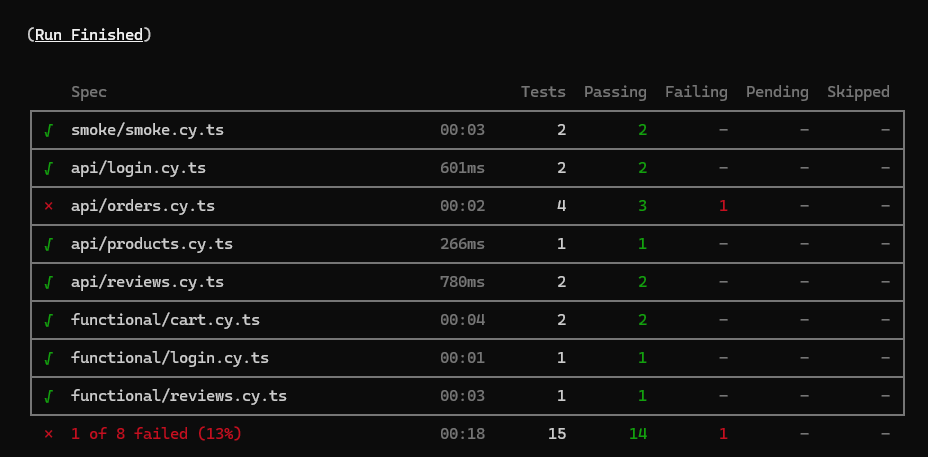

# Eco-Bliss-Bath : campagne de tests automatisés avec Cypress

Projet réalisé et validé dans le cadre de la formation **Développeur / testeur logiciel** d'OpenClassrooms (projet 10).

## Contexte

Eco-Bliss-Bath est une boutique en ligne de savons et cosmétiques éco-responsables. L'application a été **fournie par la formation** (frontend Angular, API Symfony, base de données MariaDB lancées avec Docker) : mon travail porte sur ses tests, pas sur son développement.

Dans le scénario du projet, j'interviens comme **testeur automaticien**, aux côtés de Marie, testeuse manuelle, et de Fabio, CTO. À partir du bilan de la première campagne de test manuelle, ma mission était d'automatiser les tests des fonctionnalités critiques et des 6 requêtes API principales, puis de rédiger un bilan de campagne.

## Résultats en bref

- **15 tests automatisés**, dont 14 réussis.
- **1 échec attendu** : il prouve une anomalie critique réelle de l'application (voir plus bas).
- **2 anomalies** documentées par un rapport d'incident.
- **Conclusion** : je n'apporte pas ma confiance à cette version pour une mise en production.

## Ma démarche

### Choix des tests à automatiser

- **Le login**, prérequis à toutes les autres fonctionnalités : s'il ne fonctionne pas, toute l'application est inutilisable.
- **Le panier**, qui fait intervenir le frontend, l'API et la base de données, qui doivent rester synchronisés. Un test manuel répété serait fastidieux et sujet à l'erreur humaine.
- **Les avis**, avec un test d'injection XSS sur le seul champ de texte libre de l'application.

### Tests réalisés

| Type | Fichier | Ce qui est vérifié |
| --- | --- | --- |
| API | `api/login.cy.ts` | Connexion refusée pour un utilisateur inconnu (401), acceptée avec un token pour un utilisateur valide (200) |
| API | `api/orders.cy.ts` | Panier inaccessible sans authentification (401), accessible une fois connecté (200), ajout d'un produit disponible (200), refus attendu d'un produit en rupture de stock |
| API | `api/products.cy.ts` | Détails d'un produit conformes à l'identifiant demandé |
| API | `api/reviews.cy.ts` | Avis refusé sans authentification (401), accepté une fois connecté (200) |
| Fonctionnel | `functional/login.cy.ts` | Connexion via le formulaire : les liens « Mon panier » et « Déconnexion » apparaissent |
| Fonctionnel | `functional/cart.cy.ts` | Ajout d'un produit en stock au panier, et diminution du stock affiché après l'ajout |
| Fonctionnel | `functional/reviews.cy.ts` | Une charge XSS soumise dans un avis est neutralisée : aucune alerte, attribut `onerror` retiré du DOM |
| Smoke | `smoke/smoke.cy.ts` | Présence des champs et du bouton de connexion, et des boutons d'ajout au panier une fois connecté |

Pour éviter la duplication, la connexion est factorisée dans deux commandes Cypress personnalisées (`cypress/support/commands.ts`) : `cy.uiLogin()` passe par le formulaire, `cy.apiLogin()` passe par l'API et renvoie le token.

## Anomalies détectées

### Absence de contrôle du stock lors de l'ajout au panier (criticité élevée)

- **Reproduction** : une fois connecté, envoyer `PUT /orders/add` avec un produit dont le stock est épuisé.
- **Résultat attendu** : la requête est refusée (code 400).
- **Résultat obtenu** : la requête est acceptée (code 200), le produit est ajouté au panier et le stock peut devenir négatif (jusqu'à -8 constaté).
- **Impact** : des commandes impossibles à honorer, et des données de stock faussées pour toute décision de vente ou de réapprovisionnement.

C'est ce que montre le test `should reject out-of-stock product`, volontairement laissé en échec tant que l'anomalie n'est pas corrigée. La capture de l'échec se trouve dans `frontend/cypress/screenshots/api/orders.cy.ts/`.

### Méthode HTTP incorrecte sur l'ajout au panier (criticité faible)

L'ajout au panier utilise `PUT`, alors que les bonnes pratiques réservent `PUT` au remplacement d'une ressource existante et `POST` à la création. Aucun impact fonctionnel, mais un correctif est recommandé pour la maintenabilité de l'API.

### Points analysés sans anomalie retenue

- **401 au lieu de 403 sur `/orders` sans authentification** : la première campagne attendait un 403. Sans donnée d'authentification, le serveur ne peut pas évaluer les droits de l'utilisateur : un 401 (échec d'authentification) est donc plus cohérent qu'un 403 (échec d'autorisation).
- **Injection XSS** : deux charges ont été testées sur la page Avis (`<script>` et ``), manuellement puis automatiquement. Aucun code n'est exécuté : la balise `<script>` est supprimée et l'attribut `onerror` retiré avant l'affichage.

## Compétences mobilisées

- Automatisation de tests de bout en bout et d'API avec Cypress (TypeScript)
- Choix des tests à automatiser selon la criticité et la fréquence d'exécution
- Tests de sécurité de base (injection XSS)
- Rédaction de rapports d'incident et d'un bilan de campagne
- Fiabilisation de tests face aux problèmes de synchronisation (attentes sur requêtes interceptées plutôt que délais fixes)

## Lancer le projet et les tests

### Prérequis

- Docker
- Node.js

### Installation

Cloner le dépôt :

```
git clone https://github.com/AurelSan1989/Eco-Bliss-Bath-V2.git
cd Eco-Bliss-Bath-V2
```

Démarrer l'API et sa base de données (créée automatiquement à partir du dossier `data/` au premier lancement) :

```
docker compose up -d
```

Installer les dépendances du frontend, Cypress compris, puis le démarrer :

```
cd frontend
npm install
npm start
```

L'application est alors disponible sur http://localhost:4200, et l'API sur http://localhost:8081.

### Lancer les tests

Le frontend et l'API doivent être démarrés. Depuis le dossier `frontend`, dans un second terminal :

Avec l'interface graphique :

```
npx cypress open
```

En ligne de commande, avec un résumé en fin d'exécution :

```
npx cypress run
```

Résultat attendu : 15 tests, dont 14 réussis et 1 échec correspondant à l'anomalie de stock. Une capture d'écran est générée pour chaque test en échec dans `frontend/cypress/screenshots`.

## Livrable

- [Bilan de campagne de test (PDF)](docs/bilan-campagne-de-test.pdf)

La version remise pour l'évaluation est conservée sous le tag [`v1.0-soutenance`](https://github.com/AurelSan1989/Eco-Bliss-Bath-V2/tree/v1.0-soutenance).

## Auteur

**Aurélien Girodet**, testeur logiciel junior. [Voir mon portfolio](https://p12-testeurlogiciel-portfolio.pages.dev/)
